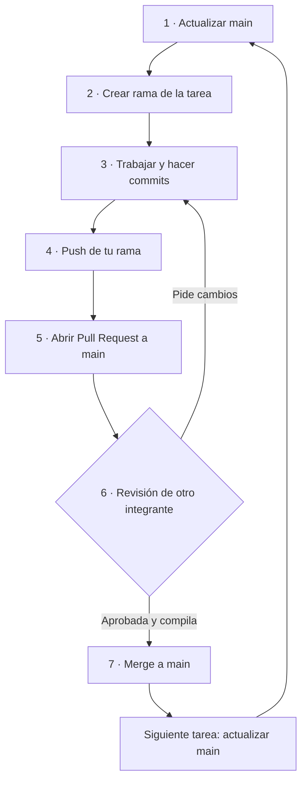

# WattControl | Panadería

**EA2 · Programación Orientada a Objetos · IU Digital de Antioquia**  
Proyecto académico en C++ para gestionar el consumo eléctrico de una panadería, proteger la refrigeración y decidir cuándo usar el horno y la amasadora.

> **Estado del proyecto:** plantilla de trabajo, **no solución terminada**. Aún existen métodos `TODO`. Que compile no significa que ya cumpla las reglas funcionales.
>
> ⚠️ **Antes de entregar:** la guía académica incluida en la plantilla original indica **máximo 3 integrantes**. Este repositorio está organizado para **4 personas por solicitud del equipo**, pero deben confirmar con el docente si se permite esa excepción. No darla por aprobada.

## 🧭 Empieza aquí

1. Completen los nombres y usuarios en [`docs/EQUIPO.md`](docs/EQUIPO.md).
2. Revisen quién trabaja en cada tarea en [`docs/REPARTO.md`](docs/REPARTO.md) y el tablero de **GitHub Projects**.
3. Cada persona trabaja en **su propia rama**. **Nunca editen `main` directamente**.
4. Antes de pedir que unan su trabajo, compilen, revisen los cambios y creen una **Pull Request (PR)**.

**Atajos:** [Flujo visual](#-flujo-visual-github-flow) · [Comandos y GitHub Desktop](#-guía-rápida-terminal-vs-github-desktop) · [Reglas de oro](#-reglas-de-oro) · [Tablero Kanban](#-github-projects-to-do--in-progress--done) · [Problemas frecuentes](#-si-algo-sale-mal)

## 🔀 Flujo visual: GitHub Flow



**En una frase:** `main` es la versión compartida; las ramas son espacios de trabajo individuales; una **PR** permite revisar antes de incorporar cambios a `main`.

### 🧑‍💻 Ejemplo completo en la terminal

Ejecuta esto **dentro de la carpeta del repositorio ya descargado/clonado**. Sustituye `a02-carga-abstracta` por el código y nombre de tu tarea.

```bash
git checkout main
git pull origin main
git checkout -b feat/a02-carga-abstracta

# Trabaja en los archivos de tu tarea; luego revisa qué cambió:
git status
git add include/Carga.h src/Carga.cpp
git commit -m "feat: implementar clase base Carga"
git push -u origin feat/a02-carga-abstracta
```

Después abre una **Pull Request** en GitHub: rama origen `feat/a02-carga-abstracta` → rama destino `main`. Pide revisión a alguien distinto de quien hizo los cambios. **No hagas merge de tu propia PR sin revisión.**

## 🧰 Guía rápida: terminal vs. GitHub Desktop

Ambos caminos sirven; **cada integrante puede elegir uno**. Si usan GitHub Desktop, primero deben tener abierto el repositorio local (menú **File → Add Local Repository**, si ya está descargado).

| ¿Qué quieres hacer? | Terminal (Git CLI) | GitHub Desktop |
|---|---|---|
| 📥 Actualizar `main` antes de trabajar | `git checkout main` y `git pull origin main` | **Current Branch → main**; luego **Fetch origin** y, si hay cambios, **Pull origin** |
| 🌱 Ver las ramas | `git branch` | Abre **Current Branch** para ver la lista |
| 🌱 Crear tu rama | `git checkout -b feat/a02-carga-abstracta` | **Current Branch → New Branch**; escribe el nombre y créala desde `main` actualizado |
| 🔁 Cambiar de rama | `git checkout nombre-rama` | **Current Branch → elige la rama** |
| 🔎 Revisar cambios | `git status` | Pestaña **Changes** (archivos modificados) |
| ➕ Elegir los archivos del commit | `git add ruta/archivo.cpp` | En **Changes**, marca solo los archivos de tu tarea (desmarca los demás) |
| 💾 Guardar un avance | `git commit -m "fix: corregir validacion de hora"` | Escribe **Summary** y pulsa **Commit to [tu-rama]** |
| ☁️ Subir tu rama | `git push -u origin nombre-rama` la primera vez; luego `git push` | **Publish branch** la primera vez; después **Push origin** |

**La PR, la revisión y el merge se hacen en GitHub (web):** abre la rama, pulsa **Compare & pull request** o **Create Pull Request**, verifica que el destino sea `main`, solicita una revisión, corrige lo necesario y espera la aprobación. Un integrante designado fusiona la PR con **Merge pull request** cuando las comprobaciones hayan terminado correctamente.

<details>
<summary>📌 ¿Qué significan los nombres de las ramas y los commits?</summary>

- **Rama:** `feat/a02-carga-abstracta`, `fix/c01-validacion` o `docs/c04-pruebas`.
- **Commits claros:** `feat: agregar clase Medidor`, `fix: validar precio positivo`, `docs: registrar pruebas reales`.
- **Una tarea por rama y PR:** usa el número real de la issue en la descripción de la PR, por ejemplo `Closes #7` (solo si esa PR completa realmente la issue 7).

</details>

## 🛡️ Reglas de oro

- 🚫 **Prohibido hacer push directo a `main`.** Los cambios entran por una PR revisada. Quien administra el repositorio debe proteger `main` en GitHub para exigir PR.
- 🔄 **Haz pull de `main` antes de crear una rama nueva.** No empieces desde una copia desactualizada.
- 🌿 **Una tarea, una rama.** No mezcles arreglos de otras actividades.
- 🔎 **Revisa `git status` y los archivos seleccionados** antes de cada commit.
- ✍️ **Commits descriptivos y auténticos.** Nada de mensajes como `cambios` o commits vacíos para completar una cuota.
- 🧪 **Compila y prueba antes del push y de solicitar revisión.** Si algo se rompe, que sea en tu rama, no en `main`.
- 👀 **Nadie aprueba su propio trabajo.** Pide una revisión a otro integrante.
- 🧩 **Coordina los archivos compartidos**, especialmente `Negocio.h` y `Negocio.cpp`. Eviten modificarlos en paralelo sin ponerse de acuerdo.
- 🔐 **No subas contraseñas ni claves**. Si aparece un conflicto o error, avisa al grupo; no fuerces cambios que no entiendas.

## 📋 GitHub Projects: To Do → In Progress → Done

- **🗒️ To Do:** tarea pendiente. Lee la issue, verifica qué archivos toca y acuerda quién la hará.
- **🚧 In Progress:** ya comenzaste en **tu rama**; enlaza la PR a la issue y mantén la tarjeta aquí mientras se revisa.
- **✅ Done:** la PR fue **aprobada y fusionada en `main`**, el cambio compila y la issue está cerrada. **Push no significa Done**.

La revisión de código ocurre mientras la tarjeta sigue en **In Progress**; si piden ajustes, corrígelos en la **misma rama** y vuelve a subirlos.

## 👥 Reparto para cuatro integrantes

| Responsable | Issues | Trabajo principal |
|---|---|---|
| Integrante 1 | A01, A02, A03 | Configuración, clase `Carga`, herencia y reglas de encendido |
| Integrante 2 | B01, B02, B03 | Mercado, Medidor, relaciones y límite de potencia |
| Integrante 3 | C01, C02, C03 | Menú, simulación de 24 horas y reporte |
| Integrante 4 | A04, B04, C04 | UML final, integración del registro de consumo y pruebas/evidencias |

Los cuatro revisan PR ajenas. **Cada estudiante debe hacer al menos 3 commits propios con trabajo real** y poder explicarlos. El reparto es una propuesta técnica; se debe conciliar con la autorización académica sobre el tamaño del grupo. Más detalle en [`docs/REPARTO.md`](docs/REPARTO.md).

## 🥖 Datos del negocio

| Equipo | Tipo | Potencia |
|---|---|---:|
| Nevera de insumos | Crítica | 1,2 kW |
| Horno eléctrico | Aplazable | 7,0 kW |
| Amasadora | Aplazable | 2,2 kW |

**Potencia contratada:** 9 kW. **Precio caro:** mayor de 800 COP/kWh. **Embalses bajos:** menos de 40 %. **Hora pico:** 18–20 (incluidas). **Horas mínimas propuestas:** horno 6 h y amasadora 4 h; deben justificarlas y avisar si no se alcanzan.

El caso de la **panadería** solo corresponde si el último dígito del documento de quien crea el repositorio es **0 o 1**. Confirmen el criterio en `docs/EQUIPO.md` sin publicar números de documento completos.

## 🗂️ Estructura del repositorio

```text
wattcontrol.cpp                  Menú de entrada (Integrante 3)
include/configuracion.h          Parámetros del negocio (Integrante 1)
include/Carga*.h                 Jerarquía de cargas (Integrante 1)
src/Carga*.cpp                   Reglas y estado de cargas (Integrante 1)
include/Mercado.h, src/Mercado.cpp       Precios y embalses (Integrante 2)
include/Medidor.h, src/Medidor.cpp       Consumo y costo (Integrante 2)
include/Negocio.h, src/Negocio.cpp       Negocio y registro (Integrantes 2 y 4)
src/Simulacion.cpp               Simulación de 24 h (Integrante 3)
src/Reporte.cpp                  Resultados y ahorro (Integrante 3)
docs/uml/                        UML editable y revisión final (Integrante 4)
docs/pruebas/                    Casos y evidencias (Integrante 4)
.github/issue-data/              12 issues listas para publicar (3 por persona)
scripts/publicar_issues.sh       Publicación de issues con GitHub CLI
```

## 🛠️ Compilar y comprobar

Con `g++` (Linux, MSYS2 o equivalente), desde la carpeta del repositorio:

```bash
g++ -std=c++17 -Wall -Wextra -pedantic -Iinclude wattcontrol.cpp src/*.cpp -o wattcontrol
./wattcontrol
```

En Windows/MSYS2, ejecuta `./wattcontrol.exe`. También puedes usar `bash scripts/compilar.sh`. No requiere librerías externas. **La compilación solo verifica la estructura**, no que todas las reglas estén implementadas.

## 🗃️ Publicar las 12 issues (responsable del repositorio)

El ZIP **no crea automáticamente las issues**. Una vez publicado el proyecto en GitHub, quien administre el repositorio puede ejecutar:

```bash
gh auth login
bash scripts/publicar_issues.sh USUARIO/wattcontrol-panaderia-equipoN
```

Sustituye `USUARIO` y `equipoN` por los datos reales. El script crea **etiquetas para cuatro integrantes** y evita duplicar issues con el mismo título; luego hay que asignar las cuentas reales en **Assignees**. Si las 12 issues **ya existen** en GitHub, el script no cambia sus responsables anteriores: actualiza **manualmente** las etiquetas y personas asignadas de **A04, B04 y C04** al integrante 4. Para publicar desde cero consulta [`docs/GUIA_GITHUB.md`](docs/GUIA_GITHUB.md).

## 🆘 Si algo sale mal

- **Estás en `main` y no has editado nada:** cambia a tu rama antes de trabajar. Si ya tienes cambios locales, **no cambies de rama a ciegas**: pide ayuda al equipo.
- **GitHub muestra cambios en conflicto:** no pulses botones al azar ni uses un push forzado; comparte el mensaje de error con quien revisa la PR.
- **Tu PR no compila:** mantén la tarjeta en **In Progress**, corrige en tu rama, haz commit y vuelve a hacer push.
- **Alguien modificó el mismo archivo:** hablen primero y coordinen quién integra los cambios, especialmente en `Negocio.cpp`.

## 🎓 Entrega EA2

La fecha indicada en la plantilla de clase es **11 de noviembre de 2026**; verificar el plazo real en la plataforma. Para entregar: terminar y probar todas las tareas, guardar evidencias de **al menos 6 pruebas**, completar el **PDF**, grabar el **video individual (máximo 5 minutos)** y colocar la etiqueta Git **`ea2`** cuando el proyecto esté finalizado. Cada persona realiza su entrega de acuerdo con la consigna. Sigue [`docs/GUIA_ENTREGA.md`](docs/GUIA_ENTREGA.md).

**Referencia académica:** `PASO_A_PASO.md` y `Proyecto_Aula_POO_WattControl.md`, proporcionados por el profesor, y AquaControl como guía conceptual. Si usan IA para entender, organizar o depurar, declaren su uso en el PDF según la actividad. **No presenten esta plantilla como solución terminada.**
