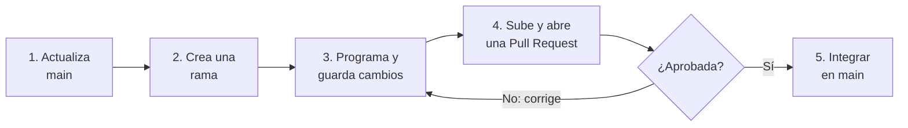

# WattControl

**Proyecto académico · C++17 · IU Digital de Antioquia**

WattControl propone gestionar el consumo eléctrico de una panadería, manteniendo la nevera como equipo prioritario y organizando el uso del horno y la amasadora.

> **Estado:** proyecto en desarrollo. Algunas funciones todavía están pendientes; que compile no significa que todos los requisitos estén terminados.

## ¿Qué debes hacer si eres integrante?

1. Consulta el [reparto de tareas](docs/REPARTO.md) y ubica tus issues en GitHub Projects.
2. Lee la issue asignada: ahí están el objetivo y los archivos que debes revisar.
3. Crea una rama y trabaja allí. **No modifiques directamente `main`.**
4. Prueba tus cambios y súbelos a GitHub.
5. Abre una Pull Request (PR) para que otro integrante los revise.

## Reparto del equipo

| Integrante | Issues | ¿De qué se encarga? | Archivos principales |
|---|---|---|---|
| **1** | A01–A03 | Configuración, clase base `Carga`, herencia, polimorfismo y reglas de encendido. | `configuracion.h`, `Carga*.h`, `Carga*.cpp` |
| **2** | B01–B03 | Mercado de energía, medidor, relaciones entre clases y potencia contratada. | Archivos `Mercado*`, `Medidor*` y coordinación de `Negocio`. |
| **3** | C01–C03 | Menú, validaciones, simulación de 24 horas y reportes. | `wattcontrol.cpp`, `Simulacion.cpp`, `Reporte.cpp` |
| **4** | A04, B04, C04 | UML final, integración del consumo, pruebas y evidencias. | `docs/uml/`, `Negocio.h/.cpp`, `docs/pruebas/` |

**Antes de empezar:** revisa la descripción de tu issue. El integrante 4 depende de entregas de los demás; además, `Negocio.h` y `Negocio.cpp` requieren coordinación entre quienes los modifican. El detalle y las dependencias están en [docs/REPARTO.md](docs/REPARTO.md).

> **Nota:** la guía de la actividad indica un máximo de tres integrantes, pero este reparto contempla cuatro. Confirmen con el docente si está autorizado.

## Cómo trabajar con Git y GitHub

Este es el ciclo que debes repetir por cada tarea:



### 1. Descargar el proyecto (solo la primera vez)

Necesitas Git y un compilador C++17. Abre una terminal:

```bash
git clone https://github.com/isaactorrenegra-coder/wattcontrol-panaderia-equipo4.git
cd wattcontrol-panaderia-equipo4
```

### 2. Crear una rama para tu tarea

Antes de empezar, actualiza tu copia y crea una rama con un nombre relacionado con tu issue:

```bash
git checkout main
git pull origin main
git checkout -b feat/mi-tarea
```

- `git checkout main`: cambia a la rama principal.
- `git pull origin main`: trae los cambios recientes del repositorio.
- `git checkout -b feat/mi-tarea`: crea tu rama y entra en ella. Cambia `mi-tarea` por el nombre de tu trabajo.

### 3. Guardar y subir tus cambios

Cuando termines una parte de tu trabajo:

```bash
git status
git add ruta/del/archivo
git commit -m "feat: describe el cambio"
git push -u origin feat/mi-tarea
```

- `git status`: muestra qué archivos modificaste.
- `git add`: selecciona los archivos que vas a guardar.
- `git commit`: registra tus cambios con un mensaje.
- `git push`: publica tu rama en GitHub. La primera vez usa `-u`; después basta con `git push`.

Repite el proceso de guardar y subir cuando avances. Usa mensajes que describan el cambio real.

### 4. Abrir una Pull Request

En GitHub, entra en **Pull requests → New pull request**:

1. En **base**, elige `main`.
2. En **compare**, elige tu rama.
3. Explica brevemente qué hiciste y solicita revisión a otro integrante.
4. Crea la PR y atiende los comentarios.

Si te piden correcciones, modifica los archivos en la misma rama y vuelve a ejecutar `git add`, `git commit` y `git push`. La PR se actualizará automáticamente. Cuando esté aprobada y probada, el integrante autorizado podrá integrarla en `main`.

**No hagas merge de tu propia PR sin revisión.**

### Palabras que verás con frecuencia

- **Repositorio:** carpeta del proyecto compartida en GitHub.
- **Rama (branch):** espacio separado para trabajar sin afectar `main`.
- **Commit:** registro de tus cambios.
- **Push:** envío de tus commits a GitHub.
- **Pull Request (PR):** solicitud para revisar e integrar tu trabajo.
- **Issue:** tarea o problema asignado.

## Probar el proyecto

Desde la carpeta principal, ejecuta:

```bash
bash scripts/compilar.sh
./wattcontrol
```

En Windows, el ejecutable puede llamarse `wattcontrol.exe`. La compilación no sustituye las pruebas funcionales.

## Documentación útil

- [Integrantes](docs/EQUIPO.md)
- [Reparto detallado, issues y dependencias](docs/REPARTO.md)
- [Guía de Git y GitHub](docs/GUIA_GITHUB.md)
- [Guía de entrega](docs/GUIA_ENTREGA.md)
- [Decisiones técnicas](docs/DECISIONES.md)

---

**WattControl · Proyecto académico de Programación Orientada a Objetos**
