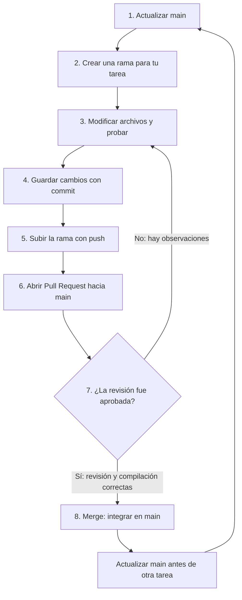

# WattControl

**EA2 · Programación Orientada a Objetos · IU Digital de Antioquia**

Proyecto académico en **C++17** para gestionar el consumo eléctrico de una panadería, proteger la refrigeración y decidir cuándo usar equipos aplazables como el horno y la amasadora.

> **Estado:** esta es una plantilla de trabajo en desarrollo. Algunos métodos todavía están pendientes. Que el proyecto compile no significa que todas las reglas funcionales estén implementadas.

## 1. ¿Por dónde empiezo?

Si eres nuevo en Git y GitHub, sigue este orden:

1. Revisa [quiénes integran el equipo](docs/EQUIPO.md).
2. Consulta el [reparto de tareas](docs/REPARTO.md) y el tablero de GitHub Projects.
3. Identifica la issue que te corresponde.
4. Crea una rama para esa tarea. No trabajes directamente en `main`.
5. Realiza los cambios, guarda commits y súbelos a GitHub.
6. Abre una Pull Request (PR) para que otro integrante revise tu trabajo.
7. Cuando esté aprobada y las comprobaciones estén correctas, se integra a `main`.

## 2. Flujo de trabajo: GitHub Flow

Este es el recorrido que debe seguir cada integrante:



**Idea clave:** `main` contiene la versión compartida del proyecto. Cada rama es un espacio de trabajo separado. La Pull Request permite revisar los cambios antes de integrarlos.

## 3. Preparar el repositorio en tu computador

Necesitas Git y un compilador compatible con C++17 (por ejemplo, `g++`). En Windows puedes usar Git Bash o MSYS2.

Abre una terminal y ejecuta estos comandos, uno por uno:

**Paso 1. Descargar el repositorio (solo la primera vez):**

```bash
git clone https://github.com/isaactorrenegra-coder/wattcontrol-panaderia-equipo4.git
```

Esto crea una carpeta con los archivos del proyecto.

**Paso 2. Entrar a la carpeta:**

```bash
cd wattcontrol-panaderia-equipo4
```

**Paso 3. Comprobar en qué rama estás:**

```bash
git branch
```

La rama activa aparece con un asterisco (`*`). Para este flujo inicial debe ser `main`.

## 4. Trabajar en una tarea: comandos explicados

Ejemplo: el integrante 1 va a trabajar en la clase abstracta `Carga`. Cambia el nombre de la rama por el de tu propia tarea.

### A. Antes de empezar: actualizar y crear tu rama

```bash
git checkout main
git pull origin main
git checkout -b feat/a02-carga-abstracta
```

¿Qué hace cada comando?

| Comando | ¿Para qué sirve? |
|---|---|
| `git checkout main` | Cambia a la rama principal. |
| `git pull origin main` | Descarga e integra los cambios recientes de GitHub en tu `main` local. |
| `git checkout -b feat/a02-carga-abstracta` | Crea una rama nueva y cambia a ella. |

### B. Mientras trabajas: revisar y guardar cambios

Cuando hayas modificado los archivos de tu tarea:

```bash
git status
git add include/Carga.h src/Carga.cpp
git commit -m "feat: implementar clase base Carga"
```

| Comando | ¿Para qué sirve? |
|---|---|
| `git status` | Muestra qué archivos cambiaste. |
| `git add` | Selecciona los cambios que incluirás en el próximo commit. |
| `git commit -m "mensaje"` | Guarda una versión de esos cambios con una descripción. |

Puedes hacer varios commits durante una tarea. Usa mensajes claros, por ejemplo: `feat: agregar validacion de potencia` o `fix: corregir calculo de consumo`.

### C. Enviar tu trabajo a GitHub

```bash
git push -u origin feat/a02-carga-abstracta
```

Esto publica tu rama en GitHub para que el equipo pueda verla. La opción `-u` se utiliza normalmente la primera vez; después puedes ejecutar simplemente `git push`.

### D. Crear una Pull Request

En GitHub, abre el repositorio. Aparecerá la opción **Compare & pull request** para tu rama; si no aparece, entra a **Pull requests → New pull request**.

1. En **base**, selecciona `main`.
2. En **compare**, selecciona tu rama (`feat/a02-carga-abstracta`).
3. Escribe un título y explica qué cambiaste.
4. Relaciona la issue correspondiente, por ejemplo `Closes #7`, solo si esa es la issue real que estás completando.
5. Solicita revisión a otro integrante y crea la Pull Request.

Si el revisor pide cambios, vuelve a editar los archivos en la misma rama, crea otro commit y ejecuta `git push`. Los cambios aparecerán en la PR existente.

**No hagas merge de tu propia PR sin revisión.** Cuando esté aprobada y compile correctamente, el integrante autorizado puede pulsar **Merge pull request**.

## 5. ¿Prefieres GitHub Desktop?

También puedes trabajar sin escribir todos los comandos. GitHub Desktop ofrece botones para realizar las mismas operaciones.

| Lo que necesitas hacer | En la terminal | En GitHub Desktop |
|---|---|---|
| Descargar el proyecto | `git clone URL` | **File → Clone repository** |
| Cambiar a `main` | `git checkout main` | **Current Branch → main** |
| Actualizar `main` | `git pull origin main` | **Fetch origin** y luego **Pull origin** si hay cambios |
| Crear una rama | `git checkout -b feat/mi-tarea` | **Current Branch → New Branch** |
| Ver qué cambió | `git status` | Pestaña **Changes** |
| Seleccionar archivos | `git add archivo` | Marcar los archivos en **Changes** |
| Guardar un commit | `git commit -m "mensaje"` | Escribir en **Summary** y pulsar **Commit to...** |
| Subir la rama | `git push` | **Publish branch** la primera vez; después **Push origin** |
| Crear la PR | En GitHub web | **Create Pull Request** o abrir GitHub web |

La revisión y el merge de la Pull Request se realizan en GitHub. Antes de publicar, revisa que solo hayas seleccionado archivos relacionados con tu tarea.

## 6. Reparto de tareas del equipo

El reparto técnico propuesto es de **tres issues por integrante**. Consulta también el detalle en [docs/REPARTO.md](docs/REPARTO.md).

| Integrante | Issues | Responsabilidad principal | Archivos o entregables |
|---|---|---|---|
| **1** | A01, A02, A03 | Configuración, clase abstracta `Carga`, herencia, polimorfismo y reglas de encendido | `configuracion.h`, `Carga*.h`, `Carga*.cpp` |
| **2** | B01, B02, B03 | Mercado de energía, medidor, relaciones entre clases y límite de potencia | `Mercado.h/.cpp`, `Medidor.h/.cpp`, integración con `Negocio` |
| **3** | C01, C02, C03 | Menú, validaciones, simulación de 24 horas y reportes | `wattcontrol.cpp`, `Simulacion.cpp`, `Reporte.cpp` |
| **4** | A04, B04, C04 | UML final, integración del registro de consumo, pruebas y evidencias | `docs/uml/`, `Negocio.h/.cpp`, `docs/pruebas/` |

**Coordinación importante:**

- El integrante 4 depende de avances de los integrantes 1, 2 y 3 para cerrar la integración y las pruebas.
- `Negocio.h` y `Negocio.cpp` son archivos compartidos: coordinen antes de modificarlos en paralelo.
- Los cuatro integrantes pueden revisar Pull Requests de los demás.
- Cada persona debe poder explicar su contribución y sus commits.

> **Nota académica:** el documento de la actividad indica un máximo de tres integrantes. El repositorio contempla cuatro; confirmen con el docente si esa conformación está autorizada.

## 7. Issues y tablero de GitHub Projects

Una **issue** representa una tarea concreta. Antes de programar, lee su descripción, revisa los archivos involucrados y confirma quién la tiene asignada.

En el tablero, utiliza estos estados:

- **To Do:** tarea pendiente; todavía no has empezado.
- **In Progress:** estás trabajando en tu rama o la Pull Request está en revisión.
- **Done:** la PR fue aprobada y fusionada en `main`, y la tarea está comprobada.

Subir el código con `push` no significa que la tarea ya esté terminada. Si la revisión solicita ajustes, la tarjeta continúa en **In Progress**.

## 8. Reglas para evitar problemas

- No hagas cambios directamente en `main`; usa una rama por tarea.
- Actualiza `main` antes de crear una rama nueva.
- No mezcles tareas distintas en una misma rama o PR.
- Ejecuta `git status` antes de seleccionar archivos y crear un commit.
- Escribe mensajes de commit que expliquen el cambio real.
- Compila y prueba antes de solicitar revisión.
- No apruebes tu propio trabajo; solicita revisión a otro integrante.
- No subas contraseñas, tokens ni claves.
- No uses `git push --force` ni resuelvas conflictos a ciegas. Pide ayuda si no entiendes el mensaje de Git.

## 9. Compilar el proyecto

Desde la carpeta principal del repositorio:

```bash
bash scripts/compilar.sh
```

También puedes compilar directamente con `g++`:

```bash
g++ -std=c++17 -Wall -Wextra -pedantic -Iinclude wattcontrol.cpp src/*.cpp -o wattcontrol
```

En Linux o Git Bash, ejecuta:

```bash
./wattcontrol
```

En Windows, el ejecutable puede llamarse `wattcontrol.exe`.

**Importante:** la compilación comprueba que el código pueda construirse, pero no demuestra que todas las reglas del proyecto estén terminadas o funcionen correctamente.

## 10. Datos del caso de la panadería

| Equipo | Tipo | Potencia |
|---|---|---:|
| Nevera de insumos | Crítica | 1,2 kW |
| Horno eléctrico | Aplazable | 7,0 kW |
| Amasadora | Aplazable | 2,2 kW |

- Potencia contratada: **9 kW**.
- Precio caro: mayor de **800 COP/kWh**.
- Embalses bajos: menos de **40 %**.
- Hora pico: de **18:00 a 20:00**, incluidas.
- Horas mínimas propuestas: horno **6 h** y amasadora **4 h**.

La nevera es prioritaria. Si las cargas aplazables superan la potencia disponible, se debe aplicar la regla de prioridad definida en el caso y documentar el resultado.

## 11. Documentación del proyecto

- [Integrantes del equipo](docs/EQUIPO.md)
- [Reparto detallado de tareas](docs/REPARTO.md)
- [Guía de Git y GitHub](docs/GUIA_GITHUB.md)
- [Guía de entrega](docs/GUIA_ENTREGA.md)
- [Decisiones técnicas](docs/DECISIONES.md)

## 12. Problemas frecuentes

**Estoy en la rama equivocada.** Comprueba tu rama con `git branch`. Si no tienes cambios sin guardar, puedes cambiar con `git checkout nombre-de-rama`. Si ya modificaste archivos, no cambies de rama a ciegas: pide ayuda.

**No aparecen mis cambios en GitHub.** Comprueba que hiciste un commit y luego ejecutaste `git push`. Verifica también que estás trabajando en la rama correcta.

**Git dice que hay conflictos.** No borres archivos ni fuerces un push para resolverlos. Comparte el mensaje con el integrante que revisa tu PR y coordinen la solución.

**Mi Pull Request necesita correcciones.** No abras otra PR para la misma tarea. Corrige los archivos en la rama existente, crea un nuevo commit y vuelve a ejecutar `git push`.

---

**Proyecto académico · IU Digital de Antioquia · WattControl**
