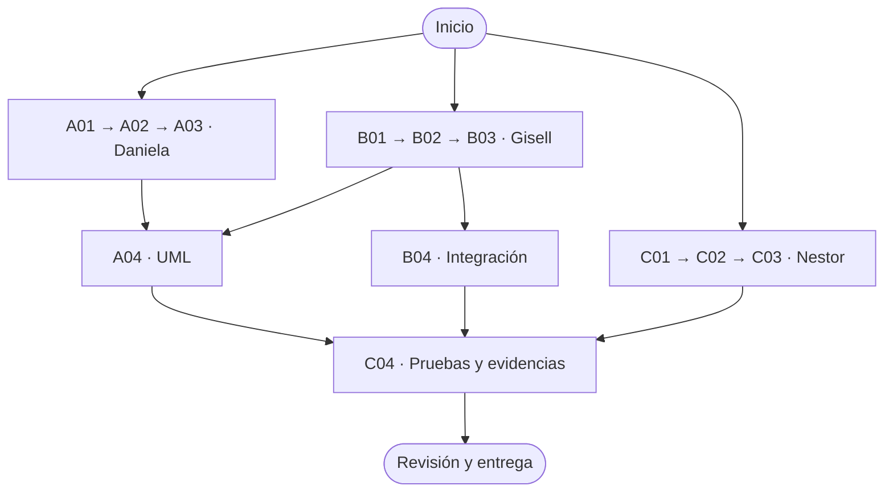

# WattControl

**Proyecto académico · C++17 · IU Digital de Antioquia**

WattControl propone gestionar el consumo eléctrico de una panadería, priorizando la nevera y organizando el uso del horno y la amasadora.

## Equipo y flujo de trabajo

| Integrante | Responsabilidad | Issues |
|---|---|---|
| Daniela | Configuración y modelo de cargas | A01–A03 |
| Gisell | Mercado de energía, medidor y negocio | B01–B03 |
| Nestor | Menú, simulación y reportes | C01–C03 |
| Isaac | UML, integración y pruebas | A04, B04, C04 |

Las tres líneas iniciales avanzan en paralelo. Las tareas de integración comienzan cuando sus dependencias estén listas.



**Para cada tarea:** abre tu Issue → crea una rama → desarrolla y prueba → abre una Pull Request hacia `main` → atiende la revisión. No trabajes directamente sobre `main`.

Consulta el [reparto detallado y las dependencias](docs/01-equipo/REPARTO.md) antes de empezar. Allí también se explican los archivos compartidos y las reglas del caso.

> **Pendiente de confirmar:** la consigna indica un máximo de tres integrantes y este equipo contempla cuatro. Confirmen la autorización con el instructor.

## Empezar

```bash
git clone https://github.com/isaactorrenegra-coder/wattcontrol-panaderia-equipo4.git
cd wattcontrol-panaderia-equipo4
bash scripts/compilar.sh
./wattcontrol
```

## Documentación

- [Integrantes](docs/01-equipo/EQUIPO.md)
- [Reparto y flujo detallado](docs/01-equipo/REPARTO.md)
- [Decisiones técnicas](docs/02-tecnico/DECISIONES.md)
- [Diagrama UML](docs/02-tecnico/uml/LEEME.md)
- [Pruebas](docs/03-pruebas/PRUEBAS.md)
- [Guía de entrega](docs/04-entrega/GUIA_ENTREGA.md)

---

**WattControl · Proyecto académico de Programación Orientada a Objetos**
