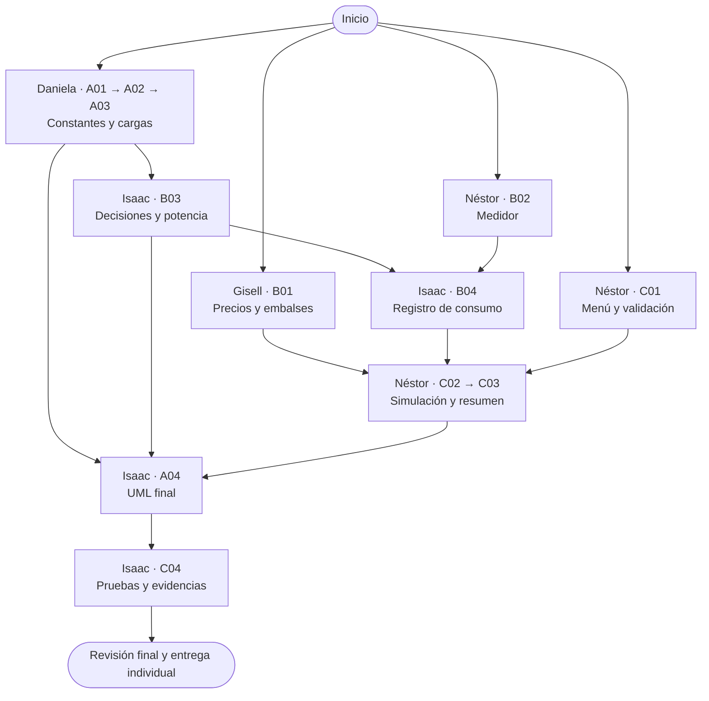

# WattControl · EA2

Gestor de energía en C++ para una panadería. El proyecto base ya compila y las tareas del equipo están en [Issues](https://github.com/isaactorrenegra-coder/wattcontrol-panaderia-equipo4/issues). Los mensajes `[PENDIENTE]` indican las funciones que cada integrante debe implementar.

La EA2 pide el programa **WattControl**, el archivo principal `wattcontrol.cpp` y un repositorio público con el formato `wattcontrol-negocio-equipoN`. Este repositorio se llama `wattcontrol-panaderia-equipo4`. El ejecutable se genera como `wattcontrol.exe` en Windows y `wattcontrol` en Linux. [Consigna EA2](https://drive.google.com/file/d/1J3zqiLZY8tIf2bVERbjZFzMEACzXJX9l/view)

| Integrante | Tareas |
|---|---|
| Daniela | A01–A03 · Constantes y cargas |
| Gisell | B01 · Precios y embalses |
| Néstor | B02, C01–C03 · Medidor, menú, simulación y resumen |
| Isaac | A04, B03–B04, C04 · UML final, control de potencia, consumo y pruebas |

## Orden de trabajo

Daniela puede empezar por A01, Gisell por B01, Néstor por B02 o C01 e Isaac por B03 cuando estén listas las cargas. El UML se elaborará al final, después de integrar y revisar el código.



Néstor puede implementar el medidor y la opción 1 del menú desde el inicio. Para la simulación necesita los precios y embalses de Gisell (B01) y el registro de consumo de Isaac (B04). Al finalizar la integración, Isaac crea el UML a partir del código real y prepara las evidencias. Consulta el [reparto](docs/01-equipo/REPARTO.md) para abrir cada tarea.

## Tutorial obligatorio de Git por tarea

> **Regla de oro:** una tarea se trabaja en una rama propia. Nunca hagas commits ni ejecutes `git push origin main` desde `main`.

### Antes de seguir: si clonaste el repositorio antes de esta limpieza

El historial de `main` fue reorganizado el **11 de noviembre de 2026**. Un clon anterior no se puede actualizar con un `git pull` normal. Conserva la carpeta antigua como respaldo y vuelve a clonar:

**Bash**

```bash
git status
cd ..
mv wattcontrol-panaderia-equipo4 wattcontrol-panaderia-equipo4-anterior
git clone https://github.com/isaactorrenegra-coder/wattcontrol-panaderia-equipo4.git
cd wattcontrol-panaderia-equipo4
```

**CMD**

```bat
git status
cd ..
ren wattcontrol-panaderia-equipo4 wattcontrol-panaderia-equipo4-anterior
git clone https://github.com/isaactorrenegra-coder/wattcontrol-panaderia-equipo4.git
cd wattcontrol-panaderia-equipo4
```

Si el primer `git status` muestra cambios o commits que aún no están en GitHub, **no borres la carpeta anterior**. Conserva ese respaldo y traslada solamente los archivos de tu tarea al clon nuevo después de coordinar con el equipo; nunca copies la carpeta `.git`. Si cualquier comando falla, detente y corrige el error antes de ejecutar el siguiente.

### 1. Configura y comprueba tu identidad

Hazlo una vez por computador y compruébalo antes de cada primer commit. Sustituye los datos de ejemplo por los de tu cuenta de GitHub.

**Bash (Git Bash, MSYS2, Linux o macOS)**

```bash
git config user.name "Tu nombre"
git config user.email "tu-correo-de-github@ejemplo.com"
git config --get user.name
git config --get user.email
```

**CMD de Windows**

```bat
git config user.name "Tu nombre"
git config user.email "tu-correo-de-github@ejemplo.com"
git config --get user.name
git config --get user.email
```

### 2. Actualiza `main` y crea la rama de tu tarea

Estos comandos se usan **siempre antes de comenzar una tarea nueva**. El ejemplo usa A01; cambia el nombre por el de tu tarea.

**Bash**

```bash
git switch main &&
git fetch origin &&
git pull --ff-only origin main &&
git switch -c tarea/a01-constantes &&
git branch --show-current &&
git status
```

**CMD**

```bat
git switch main && git fetch origin && git pull --ff-only origin main && git switch -c tarea/a01-constantes && git branch --show-current && git status
```

Los operadores `&&` garantizan que la rama se cree solamente si `main` se actualizó correctamente. Si la cadena se detiene, no crees la rama hasta resolver el error.

Usa una rama distinta para cada issue:

| Tarea | Responsable | Rama sugerida |
|---|---|---|
| A01 | Daniela | `tarea/a01-constantes` |
| A02 | Daniela | `tarea/a02-carga` |
| A03 | Daniela | `tarea/a03-tipos-carga` |
| B01 | Gisell | `tarea/b01-mercado` |
| B02 | Néstor | `tarea/b02-medidor` |
| B03 | Isaac | `tarea/b03-decisiones` |
| B04 | Isaac | `tarea/b04-consumo` |
| C01 | Néstor | `tarea/c01-menu` |
| C02 | Néstor | `tarea/c02-simulacion` |
| C03 | Néstor | `tarea/c03-resumen` |
| A04 | Isaac, al final | `tarea/a04-uml-final` |
| C04 | Isaac | `tarea/c04-pruebas` |

### 3. Revisa, compila y guarda un avance

Antes de cada commit ejecuta `git status`, revisa `git diff`, compila y agrega únicamente los archivos de tu tarea. No uses `git add .` sin revisar qué incluye.

**Bash**

```bash
git status
git diff
bash scripts/compilar.sh
./wattcontrol
git add ruta/del/archivo1 ruta/del/archivo2
git diff --staged
git commit -m "A01: describir el cambio realizado"
```

**CMD**

```bat
git status
git diff
g++ -std=c++17 -Wall -Wextra -pedantic -Iinclude wattcontrol.cpp src\Carga.cpp src\CargaAplazable.cpp src\CargaCritica.cpp src\Medidor.cpp src\Mercado.cpp src\Negocio.cpp src\Reporte.cpp -o wattcontrol.exe
wattcontrol.exe
git add ruta\del\archivo1 ruta\del\archivo2
git diff --staged
git commit -m "A01: describir el cambio realizado"
```

La EA2 pide **al menos tres commits propios por integrante**. Cada commit debe representar un avance real y tener un mensaje claro; no crees commits vacíos para completar el número.

### 4. Sube tu rama y abre el Pull Request

La primera vez que subas la rama usa:

```text
git status
git push -u origin HEAD
```

El comando es igual en Bash y CMD. Abre el enlace que muestra GitHub, crea el Pull Request hacia `main` y escribe `Closes #N` en la descripción, sustituyendo `N` por el número de tu issue.

Si `main` cambió antes de integrar tu Pull Request, actualiza tu rama:

```text
git fetch origin
git rebase origin/main
git push --force-with-lease
```

Usa `--force-with-lease` solamente en tu propia rama después del `rebase`; nunca sobre `main` ni sobre la rama de otra persona. Si aparecen conflictos, no continúes a ciegas: coordina con quien modificó el mismo archivo.

### 5. Después de integrar el Pull Request

```text
git switch main
git pull --ff-only origin main
git branch -d tarea/a01-constantes
```

Cambia el último nombre por tu rama. Para la siguiente tarea, vuelve al paso 2 y crea una rama nueva.

## Compilar y ejecutar

Si aún no tienes el repositorio, abre una terminal con Git y g++ disponibles.

**Bash**

```bash
git clone https://github.com/isaactorrenegra-coder/wattcontrol-panaderia-equipo4.git
cd wattcontrol-panaderia-equipo4
bash scripts/compilar.sh
```

**CMD**

```bat
git clone https://github.com/isaactorrenegra-coder/wattcontrol-panaderia-equipo4.git
cd wattcontrol-panaderia-equipo4
g++ -std=c++17 -Wall -Wextra -pedantic -Iinclude wattcontrol.cpp src\Carga.cpp src\CargaAplazable.cpp src\CargaCritica.cpp src\Medidor.cpp src\Mercado.cpp src\Negocio.cpp src\Reporte.cpp -o wattcontrol.exe
wattcontrol.exe
```

En Bash ejecuta `./wattcontrol`; en CMD ejecuta `wattcontrol.exe`.

[Reglas de la panadería](docs/02-tecnico/DECISIONES.md) · [Pruebas](docs/03-pruebas/PRUEBAS.md) · [Entrega individual](docs/04-entrega/GUIA_ENTREGA.md)
