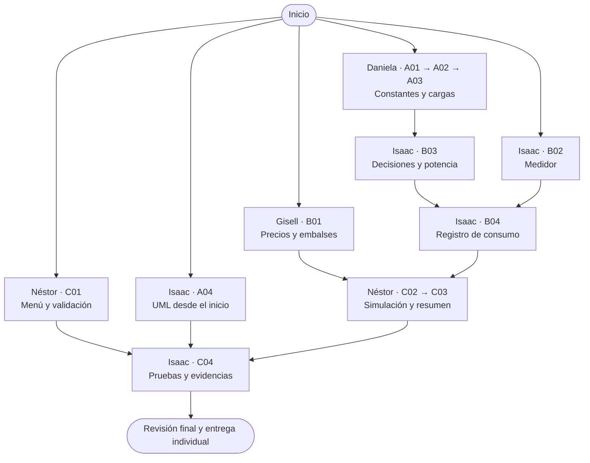
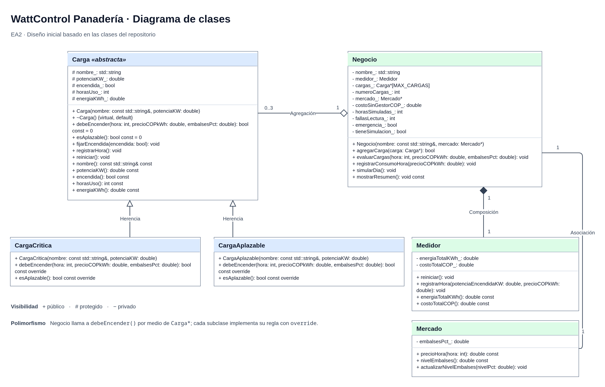

# WattControl · EA2

Gestor de energía en C++ para una panadería. El proyecto base ya compila y las tareas del equipo están en [Issues](https://github.com/isaactorrenegra-coder/wattcontrol-panaderia-equipo4/issues). Los mensajes `[PENDIENTE]` indican las funciones que cada integrante debe implementar.

La EA2 pide el programa **WattControl**, el archivo principal `wattcontrol.cpp` y un repositorio público con el formato `wattcontrol-negocio-equipoN`. Este repositorio se llama `wattcontrol-panaderia-equipo4`. El ejecutable se genera como `wattcontrol.exe` en Windows y `wattcontrol` en Linux. [Consigna EA2](https://drive.google.com/file/d/1J3zqiLZY8tIf2bVERbjZFzMEACzXJX9l/view)

| Integrante | Tareas |
|---|---|
| Daniela | A01–A03 · Constantes y cargas |
| Gisell | B01 · Precios y embalses |
| Néstor | C01–C03 · Menú, simulación y resumen |
| Isaac | A04, B02–B04, C04 · UML, medidor, control de potencia, consumo y pruebas |

## Orden de trabajo

El [diagrama UML](#diagrama-uml) ya está listo para usar desde el inicio. Daniela puede empezar por A01, Gisell por B01, Néstor por C01 e Isaac por el UML (A04) y el medidor (B02).



Néstor puede programar la opción 1 del menú desde el inicio y verificar la opción 2 cuando Isaac integre B03. Para la simulación, Néstor necesita los precios y embalses de Gisell (B01) y el registro de consumo de Isaac (B04). Antes de preparar el PDF, Isaac comprueba que el UML coincida con el código integrado y exporta esa versión. Consulta el [reparto](docs/01-equipo/REPARTO.md) para abrir cada tarea.

## Diagrama UML

[](docs/02-tecnico/uml/diagrama-wattcontrol.png)

Abre la imagen para ampliarla. Para editar el diagrama, descarga el PNG y ábrelo en diagrams.net.

## Trabajar en una tarea

1. Abre tu issue en el [reparto](docs/01-equipo/REPARTO.md) y revisa qué necesitas antes de empezar.
2. Trae los cambios de GitHub y crea tu rama desde `origin/main`. El ejemplo es para la tarea A01.

   ```bash
   git fetch origin
   git switch -c tarea/a01-constantes origin/main
   ```

3. Resuelve la tarea, compila y registra los cambios con tu cuenta. La EA2 pide **al menos tres commits propios por integrante** en el historial de entrega.

   ```bash
   git status
   git add include/configuracion.h docs/02-tecnico/DECISIONES.md
   git commit -m "Revisar constantes de la panadería"
   ```

   Cambia los archivos y el mensaje según tu tarea.

4. Sube tu rama con `git push -u origin HEAD` y abre un Pull Request hacia `main`. Escribe `Closes #4` en la descripción si tu PR completa la issue #4. Cuando aprueben el PR, intégrenlo conservando los commits. Para la siguiente tarea, repite el paso 2.

## Compilar y ejecutar

Si aún no tienes el repositorio, abre una terminal con Git y g++ disponibles. En Windows, usa la terminal Bash de MSYS2 desde VS Code.

```bash
git clone https://github.com/isaactorrenegra-coder/wattcontrol-panaderia-equipo4.git
cd wattcontrol-panaderia-equipo4
bash scripts/compilar.sh
```

Ejecuta `./wattcontrol.exe` en Windows o `./wattcontrol` en Linux. Para comprobar tu correo de autor, usa `git config user.email` y verifica que corresponda a tu cuenta de GitHub.

[Reglas de la panadería](docs/02-tecnico/DECISIONES.md) · [Pruebas](docs/03-pruebas/PRUEBAS.md) · [Entrega individual](docs/04-entrega/GUIA_ENTREGA.md)
