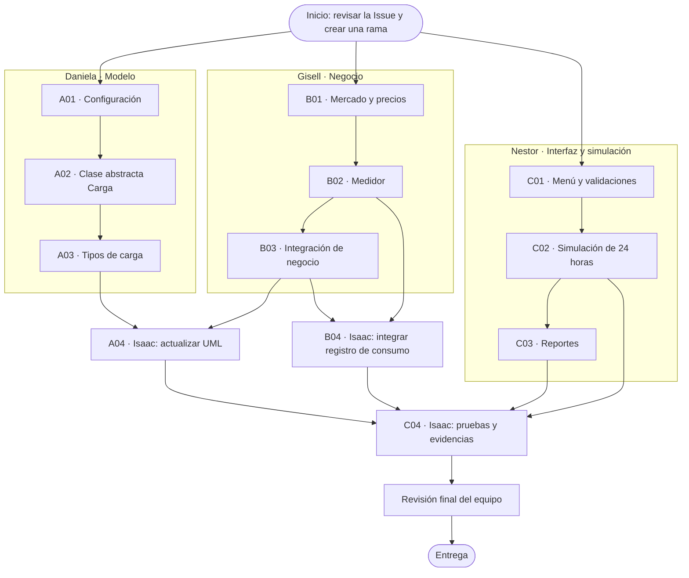

# Reparto y flujo de trabajo

Esta página responde tres preguntas: **quién hace cada tarea, en qué orden se trabaja y cuándo puede comenzar la integración**.

> **Regla sencilla:** cada persona trabaja en su Issue y en su propia rama. No esperen a que todo el equipo termine para avanzar: las tres líneas de trabajo pueden desarrollarse en paralelo.

## 1. ¿Quién hace qué?

| Integrante | Responsable de | Issues |
|---|---|---|
| **Daniela** | Modelo: configuración, clase base `Carga` y tipos de carga | [A01 #4](../../issues/4), [A02 #5](../../issues/5), [A03 #6](../../issues/6) |
| **Gisell** | Negocio: mercado, medidor y reglas de consumo | [B01 #8](../../issues/8), [B02 #9](../../issues/9), [B03 #10](../../issues/10) |
| **Nestor** | Uso del programa: menú, simulación y reportes | [C01 #12](../../issues/12), [C02 #13](../../issues/13), [C03 #14](../../issues/14) |
| **Isaac** | Apoyo de integración: UML, registro de consumo y pruebas | [A04 #7](../../issues/7), [B04 #11](../../issues/11), [C04 #15](../../issues/15) |

## 2. Flujo visual: qué va primero y qué sigue

Las tres primeras líneas se pueden trabajar **al mismo tiempo**. Las flechas muestran qué tareas necesitan que otras estén listas antes de comenzar.

### Cómo leer el diagrama

1. **Primero:** Daniela, Gisell y Nestor comienzan sus tareas iniciales en paralelo.
2. **Después:** cada uno avanza por sus Issues. No se inicia una tarea dependiente hasta que estén listos sus requisitos.
3. **Integración:** Isaac actualiza el UML cuando Daniela y Gisell terminen A03 y B03. Luego integra el registro cuando Gisell complete B02 y B03.
4. **Al final:** Isaac ejecuta C04 cuando estén listos A04, B04, C02 y C03. El equipo revisa el resultado antes de entregar.

## 3. Pasos que debe seguir cada integrante en GitHub

Para cada Issue asignada:

1. Abrir la Issue y leer qué se debe hacer y cómo se comprueba que está terminada.
2. Crear una rama propia desde `main`, por ejemplo `feat/a02-carga-abstracta`.
3. Hacer únicamente los cambios de esa tarea y probarlos.
4. Guardar los avances con commits que describan el cambio real.
5. Abrir un Pull Request hacia `main` y solicitar revisión.
6. Corregir observaciones. Integrar el cambio solo cuando esté revisado y funcione.

**No trabajen directamente sobre `main` ni editen al mismo tiempo los mismos archivos sin coordinarse.**

## 4. Coordinación en archivos compartidos

- `include/Negocio.h` y `src/Negocio.cpp`: Gisell e Isaac deben acordar primero qué implementa cada uno y las firmas de los métodos. Eviten editar estos archivos simultáneamente.
- Simulación: Nestor debe coordinar con Gisell cómo consultará el negocio y el registro de consumo.
- UML: Isaac debe representar las clases y relaciones que realmente queden implementadas; no dibujar funcionalidades supuestas.
- Pruebas: registrar resultados reales. No marcar como aprobada una prueba que todavía no se haya ejecutado.

## 5. Reglas del caso que todos deben respetar

- Potencia máxima contratada: **9 kW**. Las tres cargas suman 10,4 kW; si se supera el límite, se apaga el horno (carga aplazable de mayor potencia).
- Falla de lectura: probabilidad de 1/20 por hora; mantener la nevera y registrar su consumo.
- Emergencia: precio superior a 1500 COP/kWh y embalses por debajo del 40 %; detener el ciclo con `break`.
- Si el ciclo termina antes de 24 horas, informar las horas reales y comparar costos sobre periodos equivalentes.
- Las horas mínimas propuestas (horno 6 h y amasadora 4 h) son supuestos del equipo: deben justificarse, no presentarse como datos oficiales.

> **Pendiente de confirmar con el instructor:** la consigna original indica un máximo de 3 integrantes, pero este reparto contempla 4. Confirmen que la composición de Daniela, Gisell, Nestor e Isaac está autorizada antes de la entrega.
